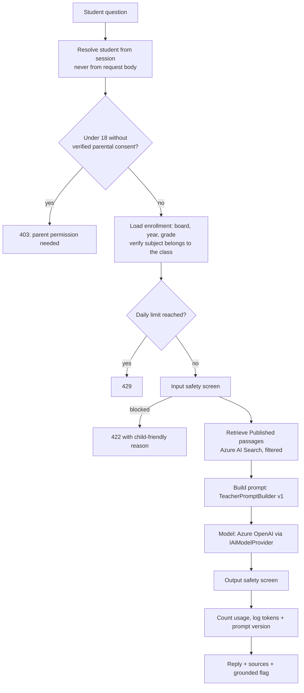

# AI Architecture

Student questions never go straight to the model. They pass through an orchestration layer (`AiTeacherService`, src/Googols.WebApi/Features/AiTeacher.cs).

## Pipeline (implemented)

## Retrieval filters (always applied)
`status eq 'Published'` and board code, academic year, grade, subject, language, plus chapter when given. Index fields: `id, title, text, kind, status, boardCode, academicYear, grade, subjectId, chapterId, topicId, language` (+ vector field in Phase 7). Indexing runs in the Worker when content is published.

## Truthfulness rule
Passages carry a `SourceKind`: `OfficialSyllabus`, `ApprovedMaterial`, or `AiGenerated`. The prompt forbids presenting the model's own wording as a textbook quotation or inventing page numbers. The UI labels ungrounded answers as *General explanation: not from your textbook*.

## Prompt-injection defence
Retrieved and uploaded text is wrapped in `<passage>` tags with `<`, `>` and `"` escaped, so content cannot close the tag. The system prompt tells the model to treat passage text as data. Unit-tested in `TeacherPromptTests`.

## Modes
Personal Teacher · Doubt Solver · Exam Coach · Revision Assistant · Practice Teacher. Each changes the instruction line, and later the template.

## Separate templates (planned)
| Template | Output | Guardrail |
|---|---|---|
| Teaching (done) | Free text | Sources, uncertainty |
| Question generation | JSON matching a schema (stem, options, key, explanation, objective, difficulty, source) | Always Draft → teacher review → publish |
| Rubric grading | JSON scores per rubric criterion + feedback | Provisional; high-stakes results need human review |
| Revision plan | Structured tasks drawn from mastery data | Only recommends existing published content |
| Parent summary | Short text from computed metrics | No raw chat content shared |

## Cost and limits
- 40 messages per student per day (Redis counter), 6 per minute (rate limiter), history trimmed to last 10 turns, max 900 output tokens.
- Each call logs model, input/output tokens, passage count and prompt version. Phase 7 persists `AIUsageLogs` with cost and plan entitlements.

## Safety
`BasicContentSafety` blocks phone numbers, email addresses and over-long input, on both input and output. **Before launch** add Azure AI Content Safety behind the same `IContentSafety` interface for harmful-content categories, plus a "report this answer" button feeding `AIInteractionFeedback`.

## Voice and images (Phase 7)
- Voice: Azure AI Speech, Malayalam (`ml-IN`) and English (`en-IN`) for speech-to-text and text-to-speech; audio isn't stored by default.
- Image doubts: multimodal model; uploaded image goes to Blob, gets moderated, is passed by short-lived SAS URL, and is deleted after 30 days.

## Evaluation
A golden set of ~200 Kerala Class 8–10 questions (Malayalam, English, mixed), with expected key points, is run in CI against prompt changes. It scores grounding, language correctness, refusal of out-of-scope requests, and injection resistance.
