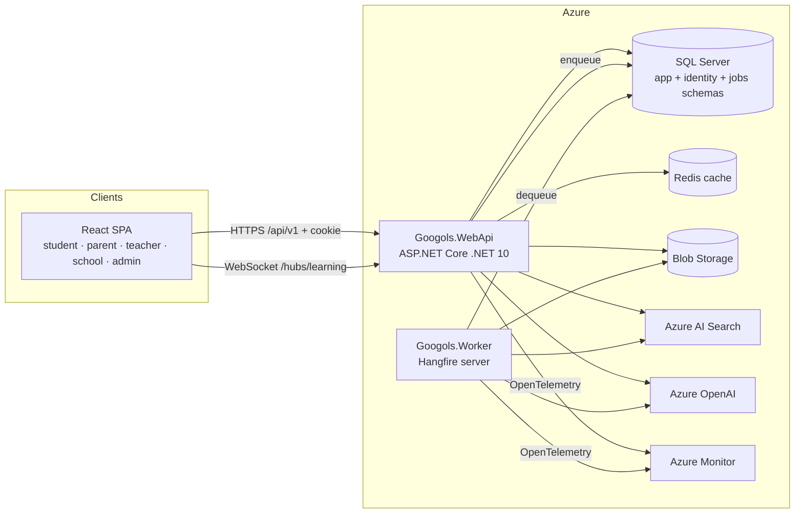

# System Architecture

## Shape: modular monolith with Clean Architecture
One deployable API plus one worker, with module boundaries inside each layer. Services are extracted only when load or team size justifies it.

## Layers and the dependency rule
| Project | Contains | May reference |
|---|---|---|
| `Googols.Domain` | Entities, enums, invariants (`StudentProfile.RequiresParentalConsent`) | nothing |
| `Googols.Application` | DTOs, validators, pure policies (`XpAwardPolicy`, `TeacherPromptBuilder`), **ports** (`IAiModelProvider`, `ICurriculumRetriever`, `IFileStorage`, `IBackgroundJobs`, `ICache`, `IRealtimeNotifier`, `IClock`, `ICurrentUser`, `IContentSafety`) | Domain, FluentValidation |
| `Googols.Infrastructure` | EF Core `GoogolsDbContext`, Identity `AppUser`, adapters for Azure OpenAI, AI Search, Blob, Redis, Hangfire | Application |
| `Googols.WebApi` | Minimal-API endpoint groups per module, auth policies, SignalR hub, exception handling, OpenTelemetry | Infrastructure |
| `Googols.Worker` | Hangfire server | Infrastructure |

`Googols.ArchitectureTests` fails the build if Domain or Application start referencing EF Core, Azure, Hangfire or outer projects.

## Module map
Modules are feature folders that repeat across layers (`Curricula`, `Students`, `Gamification`, `Ai`, …) rather than separate projects. That keeps navigation simple while the team is small. A module moves to its own project when it needs an independent deploy or owner.

| Module | Domain | Application | WebApi |
|---|---|---|---|
| Curriculum | `Domain/Curricula` | `Application/Curriculum` | `Features/CurriculumEndpoints.cs` |
| Students | `Domain/Students` | onboarding validator | `Features/StudentEndpoints.cs` |
| AI Teacher | — | `Application/Ai` | `Features/AiTeacher.cs` |
| Gamification | `Domain/Gamification` | `Application/Gamification` | `Features/Gamification.cs` |

## Key decisions
1. **Minimal APIs over controllers**: less ceremony, endpoint groups per module, works natively with OpenAPI in .NET 10.
2. **Cookie auth for the SPA, bearer available for mobile.** `AddIdentityApiEndpoints` serves both. The React dev server proxies `/api` and `/hubs`, so production can serve the SPA and API from one origin: HttpOnly cookie, no tokens in JavaScript, no CORS.
3. **Hangfire on SQL Server first**, in a `jobs` schema. Azure Service Bus is added behind `IBackgroundJobs` only if cross-service messaging becomes necessary.
4. **Redis optional in dev.** `ICache` falls back to an in-memory distributed cache.
5. **AI behind ports.** Changing model vendor or search engine touches one adapter class.
6. **GUID v7 identifiers** (time-ordered, index-friendly), UTC timestamps, audit fields set in `SaveChangesAsync`.
7. **Schemas per area**: `identity`, `curriculum`, `learning`, `gamification`, `jobs`.

## Request pipeline (WebApi)
Exception handler (problem details) → status pages → security headers → HSTS (non-dev) → HTTPS redirect → CORS → authentication → authorization → rate limiter (`auth` 10/min/IP, `ai` 6/min/user) → endpoints.

## Deployment target
- Azure Container Apps (API and Worker as separate apps, scale independently) or App Service.
- Azure SQL Database, Azure Cache for Redis, Storage account, AI Search, Azure OpenAI, Application Insights.
- Secrets in Key Vault referenced by app settings. Managed identity is the next step (`Azure.Identity` is already referenced).
- CI: GitHub Actions — `dotnet build/test`, `npm ci && npm run build && npm test`, then container build and deploy.
